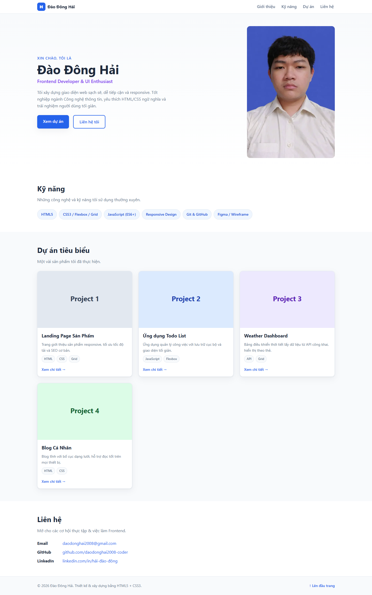
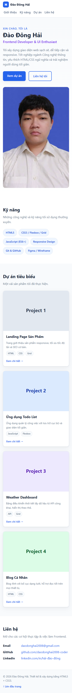

# Báo cáo kiểm thử

## Thông tin chung

- **Dự án:** Portfolio CV - Đào Đông Hải
- **Phiên bản:** v1.0
- **Ngày kiểm thử:** 27/10/2026
- **Phạm vi:** Kiểm tra trang tĩnh, giao diện responsive, tài nguyên, mã nguồn và khả năng phục vụ trên môi trường cục bộ.
- **Kết luận:** Đạt một phần. Trang hiển thị và phục vụ được trong môi trường đã thử; vẫn còn liên kết dự án mẫu và chưa xác minh Docker hoặc môi trường triển khai production.

## Môi trường và phương pháp

- **Hệ điều hành:** Windows
- **Trình duyệt:** Google Chrome (headless)
- **Viewport giao diện:** 390 × 844 px (mobile) và 1440 × 1000 px (desktop)
- **Máy chủ thử nghiệm:** Python HTTP server, cổng 8765
- **Công cụ:** Playwright điều khiển Chrome; kiểm tra phản hồi HTTP và rà soát HTML/CSS.
- Dự án không có bộ kiểm thử tự động, cấu hình lint/build hay mã JavaScript ứng dụng; vì vậy các kiểm tra chức năng được thực hiện trên trang đang chạy và bằng rà soát mã nguồn.

## Tổng hợp kết quả

| Tiêu chí | Kết quả | Tóm tắt |
|---|---|---|
| Tính đúng đắn | Đạt một phần | Trang, các mục nội dung và tài nguyên tải được; bốn liên kết chi tiết dự án vẫn là `#`. |
| UI/UX | Đạt | Đã kiểm tra hai kích thước viewport; bố cục chuyển cột phù hợp và không tràn ngang. |
| Khả năng vận hành - xử lý lỗi | Đạt một phần | Máy chủ tĩnh trả nội dung bình thường và trả 404 cho đường dẫn không tồn tại; không có luồng ứng dụng động để kiểm tra xử lý lỗi. |
| Bảo mật | Đạt một phần | Bề mặt tấn công phía trình duyệt thấp; chưa cấu hình hoặc kiểm tra các header bảo mật và chưa thực hiện kiểm thử xâm nhập. |
| Chất lượng mã nguồn | Đạt một phần | HTML/CSS có cấu trúc responsive và các tài nguyên tải được; chưa có lint, build hoặc test suite để kiểm tra tự động. |
| Khả năng triển khai | Đạt một phần | Đã chạy trang tĩnh qua HTTP trên Windows; chưa xác minh Docker, macOS, Linux hoặc máy chủ production. |

## 1. Tính đúng đắn

**Kết quả: Đạt một phần**

- Trang trả HTTP 200; tiêu đề, phần giới thiệu, kỹ năng, dự án và liên hệ xuất hiện trong trang.
- Các liên kết điều hướng nội bộ có mục tiêu tương ứng (`about`, `skills`, `projects`, `contact`).
- Ảnh đại diện và bốn ảnh minh họa dự án đều tải thành công trong trình duyệt.
- Tệp HTML, CSS và ảnh WebP trả HTTP 200 từ máy chủ thử nghiệm.
- Đường dẫn tệp không tồn tại trả HTTP 404.
- **Tồn tại:** Cả bốn liên kết “Xem chi tiết” đều đang trỏ tới `#`, chưa mở trang dự án hoặc bản demo.

**Minh chứng giao diện:** [Ảnh desktop](../docs/screenshots/desktop.png), [ảnh mobile](../docs/screenshots/mobile.png).

## 2. UI/UX

**Kết quả: Đạt**

- Đã xem trực tiếp trang ở viewport 390 px và 1440 px.
- Ở 390 px, lưới dự án hiển thị một cột; ở 1440 px, hiển thị ba cột.
- Chiều rộng tài liệu bằng chiều rộng viewport trong cả hai lần thử; không phát hiện tràn ngang.
- Điều hướng, nội dung, ảnh đại diện và các thẻ dự án hiển thị trong ảnh chụp toàn trang.
- CSS có trạng thái focus nhìn thấy được và hỗ trợ `prefers-reduced-motion`.
- **Giới hạn kiểm tra:** Chưa đánh giá khả năng tiếp cận bằng công cụ chuyên dụng hoặc thử nghiệm người dùng trên nhiều trình duyệt/thiết bị thực.

**Minh chứng:** [Ảnh desktop](../docs/screenshots/desktop.png) · [Ảnh mobile](../docs/screenshots/mobile.png).

## 3. Khả năng vận hành - xử lý lỗi

**Kết quả: Đạt một phần**

- Máy chủ HTTP cục bộ phục vụ trang và các tài nguyên cần thiết thành công.
- Trang chạy trong trình duyệt không phát sinh lỗi JavaScript; các ảnh đều tải thành công.
- Khi yêu cầu một đường dẫn tĩnh không tồn tại, máy chủ trả HTTP 404 thay vì báo thành công.
- Đây là website tĩnh, không có API, backend, cơ sở dữ liệu hoặc biểu mẫu gửi dữ liệu; do đó không có luồng xử lý lỗi nghiệp vụ, lỗi mạng API hay xác thực để kiểm tra.

## 4. Bảo mật

**Kết quả: Đạt một phần**

- Rà soát mã nguồn không thấy thẻ `<script>`, biểu mẫu nhập liệu hoặc stylesheet bên thứ ba; CSS và ảnh được tham chiếu từ dự án.
- Các liên kết ngoài mở tab mới có `rel="noopener noreferrer"`.
- Không phát hiện khóa API hoặc cấu hình bí mật trong các tệp được kiểm tra.
- **Giới hạn:** Chưa cấu hình/kiểm chứng CSP, HSTS, HTTPS hoặc các HTTP security headers vì dự án không kèm cấu hình máy chủ production. Đây là rà soát cơ bản, không phải kiểm thử xâm nhập hay đánh giá bảo mật toàn diện.

## 5. Chất lượng mã nguồn

**Kết quả: Đạt một phần**

- Nội dung được tách thành HTML và CSS; CSS dùng Flexbox, Grid, biến giao diện và media queries cho responsive.
- Các ảnh có văn bản thay thế; cấu trúc có tiêu đề, điều hướng và các phần nội dung riêng.
- Các kiểm tra trình duyệt xác nhận đủ bốn mục nội dung chính và năm ảnh hiển thị thành công.
- **Giới hạn:** Repository chưa có test suite, linter, formatter hoặc quy trình build tự động; chưa có kết quả kiểm thử tự động để xác nhận chất lượng toàn diện.

## 6. Khả năng triển khai

**Kết quả: Đạt một phần**

- Đã chạy thành công bằng Python HTTP server trên Windows và truy cập trang tại `http://localhost:8765/`.
- Vì đây là website tĩnh, có thể phục vụ thư mục nội dung bằng máy chủ web tĩnh phù hợp.
- **Chưa kiểm chứng:** Chạy bằng Docker, triển khai trên macOS/Linux, cấu hình tên miền/HTTPS, cache, logging và máy chủ production. Môi trường kiểm thử hiện tại không có Docker CLI.

## Ảnh minh chứng

Ảnh được chụp trực tiếp từ trang đang chạy bằng Chrome/Playwright ở ngày kiểm thử.

### Desktop — 1440 px

### Mobile — 390 px

